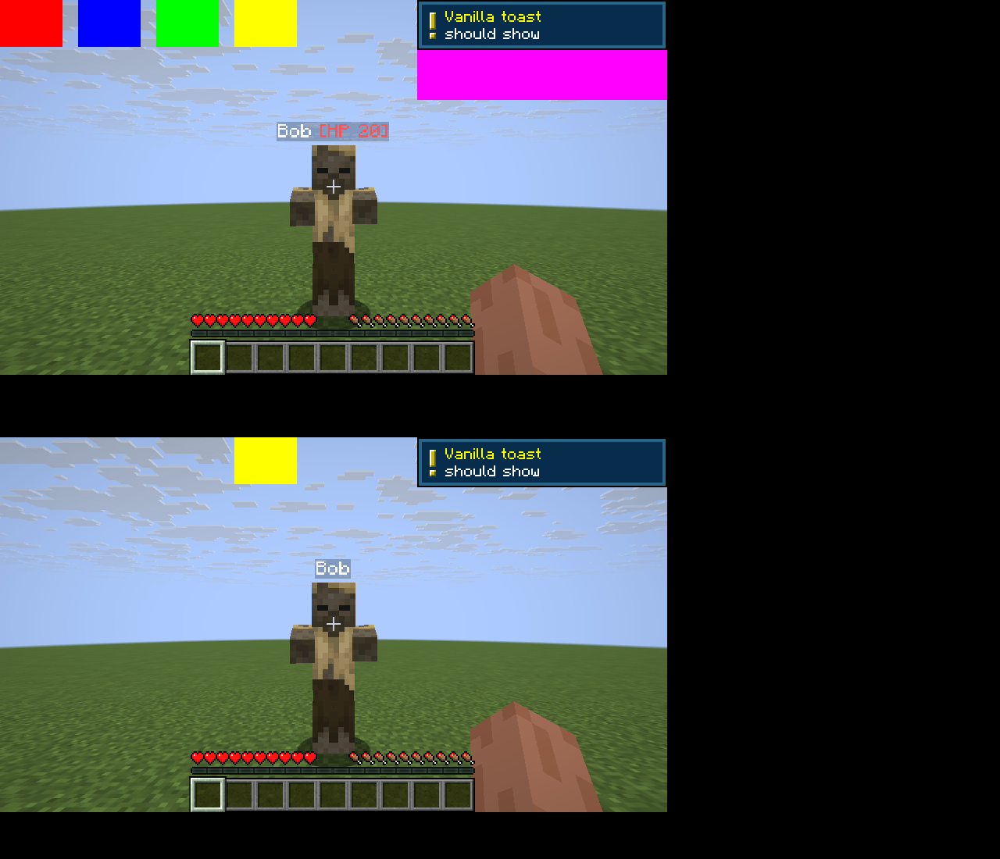
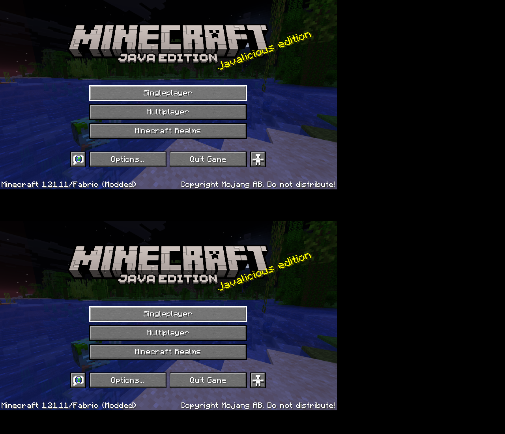
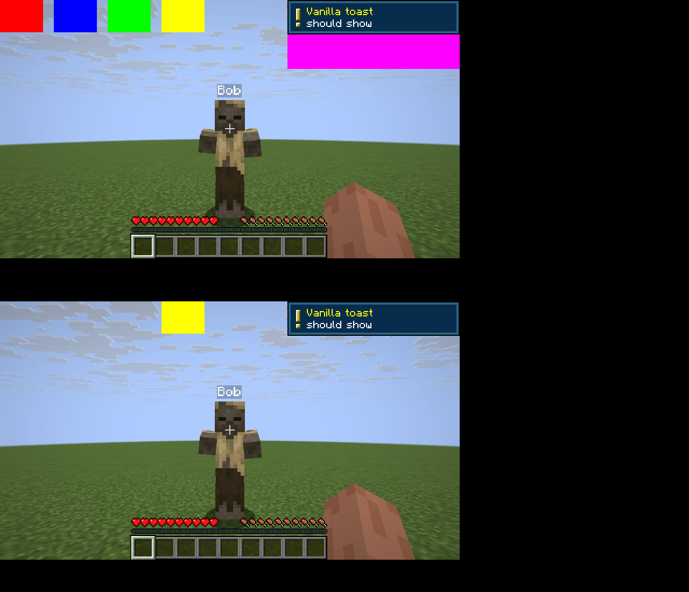
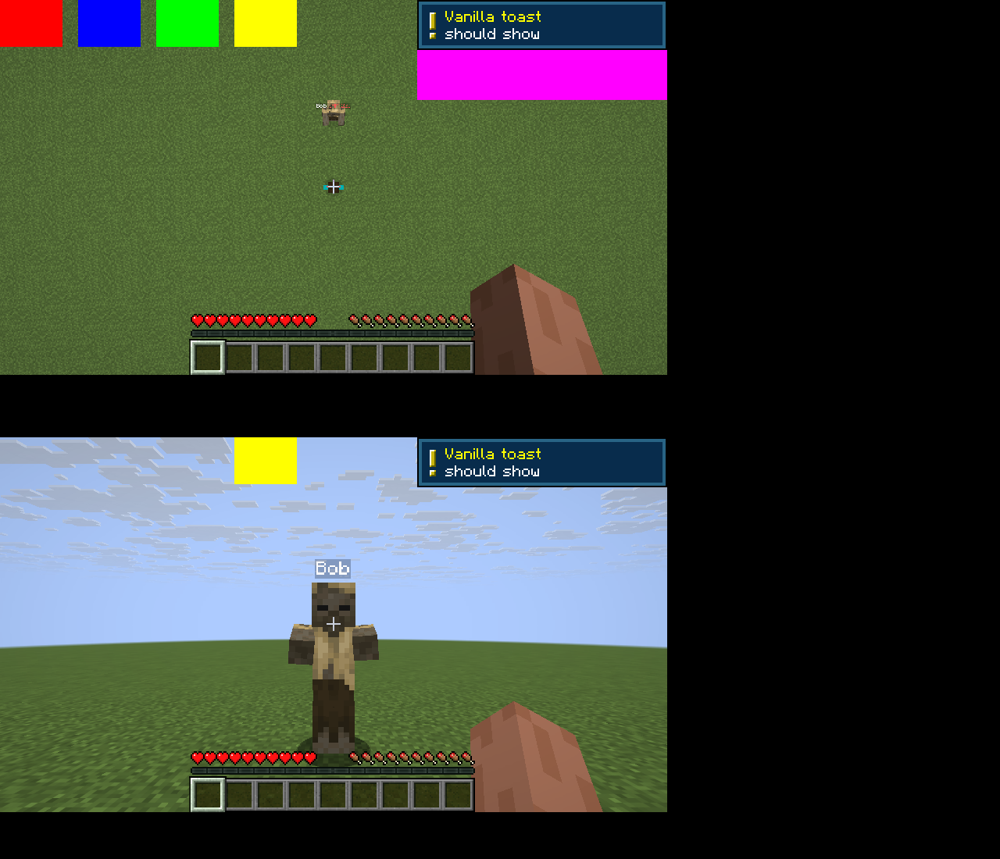
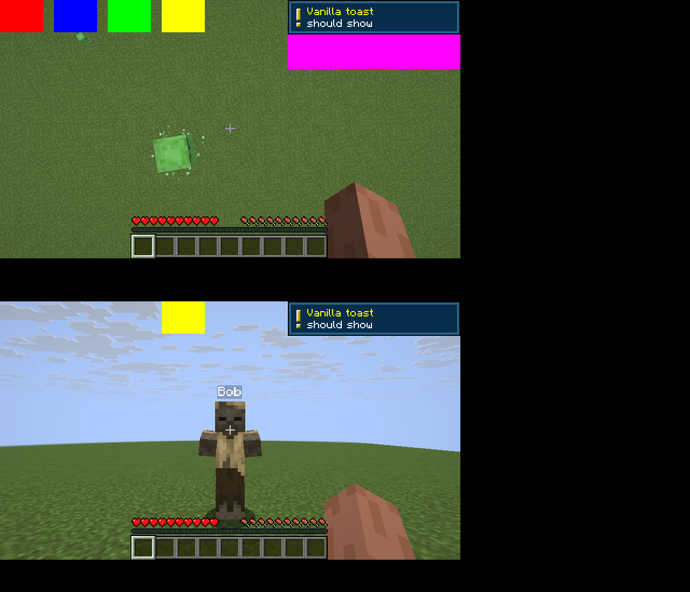
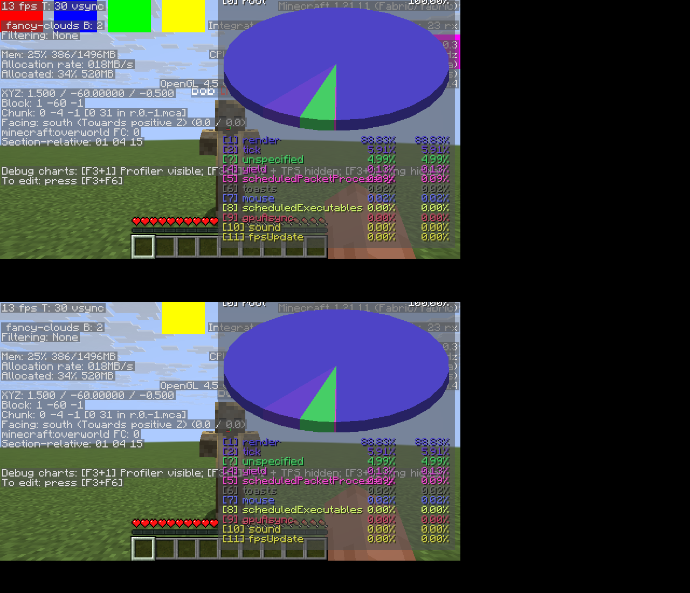
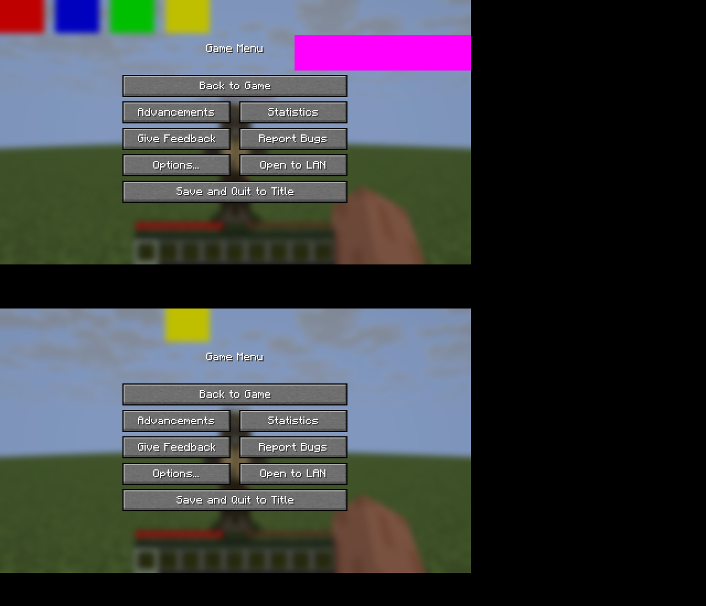
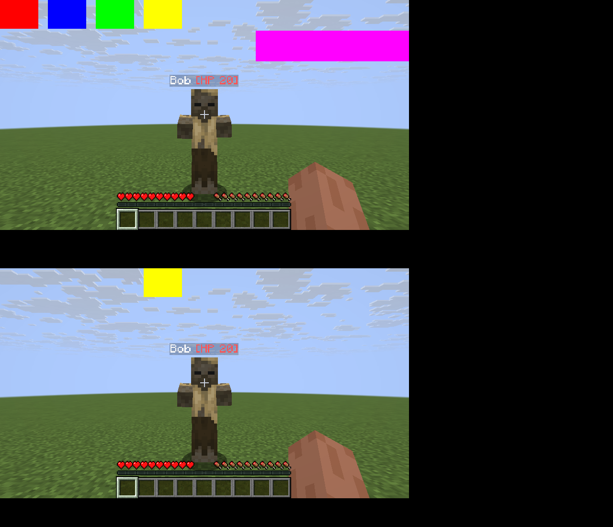

# CleanMirror — Fabric 1.21.11

[](https://github.com/Eabusham2/CleanMirror/actions/workflows/build.yml)
[](https://github.com/Eabusham2/CleanMirror/releases/latest)


[](LICENSE)

A second Minecraft window that shows your game **without your mods on it**, for streaming a clean, vanilla-looking feed while you play with a full mod list.

**F6** opens/closes it. Point OBS's *Window Capture* at the window titled **Clean Feed**.


<sub>Top: your window, with four fake mod overlays, a mod toast and a health-nametag mod. Bottom: the clean window, with only the whitelisted Simple Voice Chat slot (yellow) and plain vanilla names.</sub>

## Download

Grab **`cleanmirror-<version>.jar`** from the [**latest release**](https://github.com/Eabusham2/CleanMirror/releases/latest) and put it in `.minecraft/mods` with:

| Mod | Needed? |
|---|---|
| [Fabric API](https://modrinth.com/mod/fabric-api) | **yes** |
| [Mod Menu](https://modrinth.com/mod/modmenu) | for the settings screen |
| [Cloth Config](https://modrinth.com/mod/cloth-config) | for the settings screen |

---

## Status: verified in the real game

This build was compiled against the actual Minecraft 1.21.11 code (Yarn build.6, Fabric API 0.141.6, Loader 0.19.5) and then **run in the real game** (virtual display, software graphics) with a set of fake "mods" built to leak onto the stream. Both windows were captured off the screen for every scene. Pictures are in **`test-screenshots/`**: top half is your window, bottom half is the clean window.

| Scene | Your window | Clean window | Result |
|---|---|---|---|
| Title screen | menu + panorama | identical | ✅ |
| Red block: mod HUD piece with a name | shown | gone | ✅ |
| Blue block: Fabric's old nameless HUD callback | shown | gone | ✅ |
| Green block: injection into `InGameHud.render()`, the way Meteor-style clients hook their HUD | shown | gone | ✅ |
| Yellow block: piece named `voicechat:hud`, exactly how Simple Voice Chat 1.21.11 registers its mic icon | shown | **shown** (whitelisted) | ✅ |
| Magenta toast from a mod / vanilla toast | both | vanilla only | ✅ |
| Health-tag mod (`Bob [HP 20]`), REUSE | `Bob` | `Bob` | ✅ (both windows, by design) |
| Health-tag mod, REDRAW | `Bob [HP 20]` | `Bob` | ✅ |
| Freecam 12 blocks up, looking down (REDRAW) | freecam view | view from your head, full terrain | ✅ |
| Freecam moved 20 blocks sideways (REDRAW) | freecam view | view from your head, full terrain | ✅ |
| F3 + pie chart | shown | identical, every slice | ✅ |
| Pause menu (with blur) | shown | identical | ✅ |

A pixel count across every scene found **zero** red, blue, green or magenta pixels in the clean window.

<details>
<summary><b>Show all test screenshots</b> (top = your window, bottom = clean window)</summary>

| | |
|---|---|
| Title screen<br> | REUSE mode<br> |
| REDRAW mode<br> | Freecam up 12 blocks<br> |
| Freecam moved sideways<br> | F3 + pie chart<br> |
| Pause menu<br> | Nametags AS IS<br> |

</details>

To re-run it yourself: `./gradlew runAutopilot` (screenshots land in `build/run/autopilot/cleanmirror-test-out/`).

What a test machine can't prove: your GPU and driver, and your exact mod list. If something misbehaves, the log line plus your mod list is what I need.

---

## How it works

### The HUD: rebuilt, not filtered after the fact

In 1.21.11, Minecraft's `InGameHud.render()` draws the HUD one piece at a time. Clients like Meteor also **inject their own HUD into that method**. So the clean feed never calls it. CleanMirror rebuilds the same steps in the same order from the 1.21.11 source, and sends every piece through Fabric's named HUD layers:

```
minecraft:hotbar      vanilla        -> shown unless you untick it
voicechat:hud         Simple Voice Chat -> shown because "voicechat" is ticked
anything:else         any other mod  -> hidden until you tick it
```

Anything hooked onto `render()` itself never runs on the feed. A mod you install next month starts out hidden.

### The world: two modes

| | **REUSE** (default) | **REDRAW** |
|---|---|---|
| Cost | almost nothing (copies your finished world) | a second world render per clean frame |
| Mod HUD overlays | gone | gone |
| Nametag cleaning | applies to **both** windows | applies to the **stream only** (you keep health bars) |
| Freecam | shows on the feed | **feed stays at your body** |
| Own FOV / hide hand | no | yes |

The frame-rate limit is checked before any work, so skipped frames cost nothing. At 30 FPS, REDRAW pays for its extra render 30 times a second.

### Nametags

Health-bar mods change the **name text itself**, and many also force names onto every mob. CleanMirror lets everything run, then overwrites the result with what vanilla would show: the entity's real name (team colours kept), visible only where vanilla's own rules show it. Those rules are copied from the 1.21.11 source rather than called, so a mod that changes them can't change ours.

**Strict labels** (off by default) also skips anything mods add *while drawing* a label. It's off because that's also where Simple Voice Chat draws its speaker icon above heads.

### Freecam (REDRAW)

In 1.21.11 the camera is placed once per frame, then the world reads it. For the clean redraw, CleanMirror snapshots the camera, re-poses it the way vanilla would from your body, writing directly into its fields (freecam mods hook the camera's *methods*), draws, then restores everything. That includes what you're aiming at, so your clicks never depend on the clean view. F5 third-person and real spectating (spectator mode, following a mob) still mirror, because those are vanilla.

### F3 and the pie chart

F3 is drawn on the feed whenever you have it open, charts included. The clean pass runs inside its own profiler section, **`cleanmirror`**, so every vanilla slice of the pie chart (block entities included) reads exactly as it would without the mod, and the feed's cost appears as its own slice.

---

## Keys

| Key | |
|---|---|
| **F6** | open / close the clean window |
| **F7** | list every HUD piece the game has drawn in chat, green = on the feed, grey = hidden |

F7 is how you fix anything without code: find the piece's name, then tick or untick it in settings.

---

## Settings (Mod Menu → CleanMirror → gear)

- **Mode**: REUSE / REDRAW, freecam-proofing, stream FOV, hide hand
- **Window**: title (what OBS shows), size, frame-rate limit, fit (letterbox / crop / stretch), borderless, always on top, vsync, open at startup
- **Nametags**: VANILLA / OFF / AS IS, team colours, strict labels
- **Vanilla HUD**: every vanilla HUD piece as its own checkbox, plus F3/charts
- **Mods**: fills itself in with every mod that has drawn on your HUD; plus exact-piece list and the nameless-callback switch
- **Menus & popups**: vanilla menus, mod menus, connection screens, toasts, mod toasts

Without Cloth Config, the gear shows a note instead of crashing; edit `config/cleanmirror.json` by hand. Changing window size or border re-creates the window immediately.

---

## Known limits

- **Changes inside a vanilla piece stay.** A mod that alters a vanilla element from the inside (AppleSkin's hunger preview inside the food bar, say) is part of that element. Untick the element to remove both.
- **Mod buttons added to vanilla menus show.** Mod Menu's *Mods* button on the pause screen is a vanilla button on a vanilla screen.
- **Other mods' 3D world drawing isn't removed.** In REUSE it's already in the copied picture. In REDRAW those mods hook the world render and run again.
- **REDRAW + freecam further away than your render distance:** the clean view gets its own visible-chunk list, but the game only keeps chunks loaded around *your* camera. Terrain around your body may then be missing on the stream until you fly back.
- **REDRAW with Iris shaders** is untested and likely to misbehave. Use REUSE with shader packs.
- **Clicking the clean window takes focus** from the game, which pauses it if *Pause on Lost Focus* is on. OBS doesn't need it focused.

This is purely visual. It changes what's on your screen, nothing else.

---

## Building

See **[BUILD.md](BUILD.md)**. Short version: Java 21, then `./gradlew build` (Windows: `gradlew.bat build`). The mod is `build/libs/cleanmirror-<version>.jar`.

**Releases are automatic:** every push is built by GitHub Actions, and pushing a tag like `v1.0.1` publishes a release with the jar attached.

To re-run the in-game test yourself: `./gradlew runAutopilot`.
